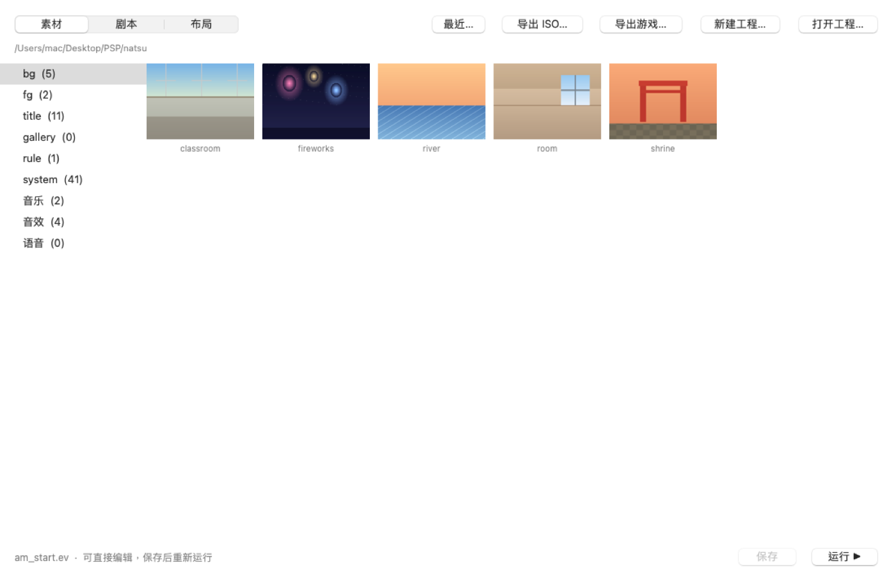
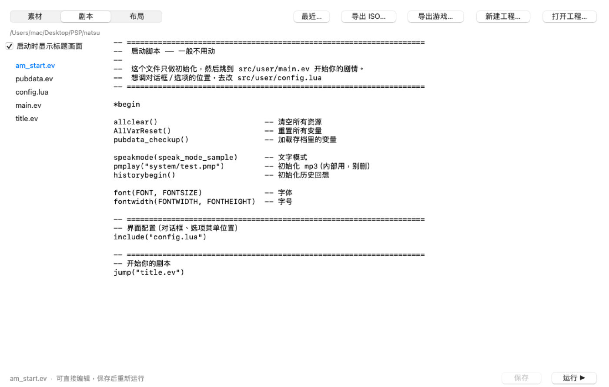
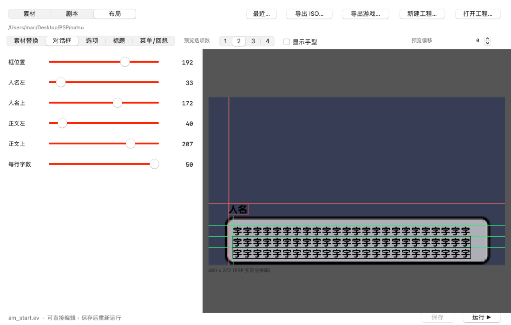

# PGM Studio — Pocket Game Maker for macOS

**Pocket Game Maker (PGM)** 是白枫 / 掌机开发者之家做的 PSP 文字游戏引擎，圈内也叫
「PGM 引擎」，用来制作和移植视觉小说、文字 ADV。原版只有 Windows 打包工具，没有 Mac 版。

这个项目用 **macOS 原生**重写了整套开发环境，叫 **PGM Studio**：

- 原生 App（Apple Silicon + Intel），不是 Wine / 虚拟机
- 素材浏览、剧本编辑、界面布局、一键运行
- 导出的游戏能直接发给别人双击玩，也能导出 PSP 用的 ISO
- 兼容原版 PGM 和 PGM_CE 的工程与 `.ev` 脚本

### 关键词 / Keywords

`Pocket Game Maker` `PGM` `PGM Studio` `PGM_CE` `白枫` `掌机开发者之家` `掌机自制游戏`
`PSP homebrew` `PSP visual novel` `文字游戏` `视觉小说` `AVG` `Galgame` `Lua`
`macOS 移植` `Apple Silicon` `PPSSPP` `ISO` `同人游戏` `KiriKiri` `NScripter` `ONScripter`

## 界面

**素材** —— 分类浏览，点一下复制指令，音频可试听



**剧本** —— 内置编辑器，改完直接运行



**布局** —— 拖滑块调对话框/选项/标题位置，右边实时预览



## 两种用法

**只想玩 / 只想做游戏** → 下载 Releases 里的 `PGM-Studio.dmg`，把 App 拖进「应用程序」，双击打开。

**想要源码 / 想自己编译** → 继续往下看。

## 从源码编译

```sh
brew install libpng jpeg-turbo giflib freetype
./engine/scripts/build.sh Release        # 引擎
./engine/scripts/build-studio.sh         # 工作台
./engine/scripts/make-dmg.sh             # 打成可分发的包
```

## 目录

```
bin/       运行时：音乐、音效、语音、字体
src/       你的游戏：剧本、图片、框架脚本
engine/    引擎与工具源码（不用改）
教程.md     怎么用
```

## 许可

MIT。PGM 作者白枫、libnge2 作者 Kun Wang 均已同意。


## 致谢

白枫（掌机开发者之家）、Kun Wang（libnge2）、History-exe（PGM 原版与 CE）
