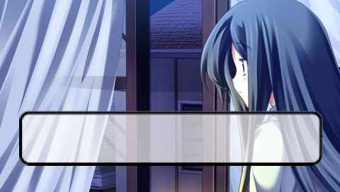
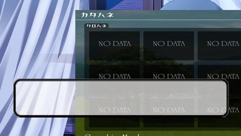

# PGM-Mac

把 PSP 时代的自制文字游戏引擎 **Pocket Game Maker (PGM)** 移植到 macOS。

> **当前状态：可以跑游戏了。**
> 引擎在 macOS 上原生运行，直接读取玩家拿到的 `gmcode.bin` / `gmdata.bin` 二进制封包，
> 背景、立绘、对话框、彩色中文文本都能正确渲染。原版 v0.83 与 PGM_CE 两套 Lua 框架
> 都能加载运行，零错误。
>
> **已知限制**：还没有声音（CoreAudio 后端待实现）；只在 Apple Silicon（arm64）上验证过。

---

## 这是什么

[PGM](https://github.com/History-exe/PGM_CE) 是「掌机开发者之家」的白枫为 PSP 写的
AVG / 视觉小说引擎。国内现存的 PSP 自制移植游戏绝大多数都是用它做的 ——
包括《逆熵 Anti-Entropy》《幽兰黛尔》这类崩坏 3 视觉小说移植版。

它原本只支持 **PSP / Windows / Android**，从来没有 macOS 版本。这个项目补上了这一块。

## 目录结构

```
先看这两个：
  开始.md                  ← 三步上手（中文，最直接）
  运行游戏.command          ← 双击：编译 + 运行骨架工程
  做新游戏.command          ← 双击：生成你自己的工程

   starter/                ← 骨架工程，复制它开始做游戏
   engine/                 ← 引擎本体（不用动）
      host/                ←   PGM 宿主层，自写 3800 行
      third_party/         ←   libnge2 + Lua 5.1.4
   scripts/                ← 构建、打包、生成工程
   docs/                   ← 文档
```

## 三步做游戏

```sh
./scripts/build.sh Release          # 构建引擎（一次）
./scripts/new-project.sh 我的游戏    # 生成工程
cd 我的游戏 && ./run.sh             # 跑起来
```

然后**只改一个文件**：`src/user/main.ev`。

```
text("你好，世界。")
textcl()
```

改完保存、重新运行就生效 —— **不需要打包，不需要任何 Windows 工具，也不用管编码**。

`starter/README.md` 逐条讲了台词、图片、音乐、选项怎么写。

## 运行现成的 PGM 游戏

```sh
./build/Release/pgm-mac /path/to/游戏目录
```

或者打包成可双击的 `.app`（把游戏一起塞进去，拷到别的 Mac 也不用装依赖）：

```sh
./scripts/make-app.sh Release /path/to/游戏目录
open build/PGM.app
```

也可以把游戏文件夹**直接拖到 `PGM.app` 图标上**。

游戏目录的结构：

```
游戏目录/
├── bin/
│   ├── pgm.ini            ← 窗口大小、路径配置
│   ├── engine.sys         ← 框架引导脚本
│   └── data/
│       ├── gmcode.bin     ← 脚本封包（可选）
│       ├── gmdata.bin     ← 图片封包（可选）
│       ├── font/  system/
│       └── bgm/ sound/ voice/ video/
└── src/
    ├── am_start.ev        ← 入口
    ├── system/            ← 框架脚本
    ├── user/              ← 你自己写的剧本
    └── files/             ← 你自己放的图
```

### 没有封包也能跑

原版的工作流是「写 `src/` → 跑 `pgsp.exe` 打 `gmcode.bin` → 跑 `pgrp.exe` 打 `gmdata.bin`」。那两个是 Windows 程序，macOS 上跑不了。

所以这个移植版**在封包文件不存在时自动改读散装目录**：脚本读 `src/`，图片读 `src/files/`。改脚本、丢张图进去，直接运行就见效。

想验证玩家拿到的封包形态，设 `PGM_MAC_PACK=1` 强制走二进制封包。

## 架构

PGM 是两层结构，移植的难点完全在第二层：

```
┌─────────────────────────────────────────────┐
│  游戏内容（Lua 脚本 + 图片 + 字体 + 音频）      │  ← 纯 Lua，天然跨平台
│  src/system/*.lua, src/user/*.ev, files/     │
│  打包成 gmcode.bin / gmdata.bin              │
└──────────────────┬──────────────────────────┘
                   │  ~150 个原生 API
┌──────────────────▼──────────────────────────┐
│  PGM 宿主层（闭源，本项目重新实现）             │  ← 主要工作量在这里
│  LuaLibs.cpp / MyGame.cpp / PGMap.cpp       │
│  amp_package.cpp                            │
└──────────────────┬──────────────────────────┘
                   │
┌──────────────────▼──────────────────────────┐
│  NGE2 多媒体引擎（BSD/GPL，开源）              │  ← 已移植完成 ✓
│  Lua 5.1.4 · OpenGL · FreeType               │
└─────────────────────────────────────────────┘
```

## 已完成

### 引擎移植

* `libnge2` 用 CMake + clang 在 macOS 14 / Apple Silicon 上编译通过
* 新增 `NGE_MAC` 后端：Cocoa 窗口 + NSOpenGL 上下文 + 事件桥接 + 键位映射
* 渲染正确性通过**像素级验证**（绘制 → `glReadPixels` 回读 → PNG）

### 封包解码

**`gmcode.bin` 与 `gmdata.bin` 的格式已完全破解**，解密结果通过真 Lua 5.1 语法检查
（40 个 `.lua` 文件 0 失败）。完整逆向记录见 [docs/PACK-FORMAT.md](docs/PACK-FORMAT.md)，
包括那个很有意思的发现：**打包器为避免密文出现 `0x00`（C 字符串截断）会把这类字节原样写出**。

### 宿主层

| 模块 | 内容 |
|---|---|
| `src/pgm_main.c` | 启动链、主循环、双击时的游戏目录查找、截图 |
| `src/pgm_lua.c` | Lua 5.1 状态、脚本加载、错误报告 |
| `src/pgm_pack.c` | 两种封包的读取 + 明文目录回退 |
| `src/pgm_gfx.c` | 图像/字体/计时器 API、视频初始化 |
| `src/pgm_escript.c` | `.ev` 事件脚本解释器 |
| `src/pgm_mem.c` | 裸内存缓冲区 + 定长字段读写 |
| `src/pgm_dialog.c` | 对话文本解析（颜色标签、换行、GBK 双字节） |
| `src/pgm_effect.c` | 效果器（淡入淡出/震动/过渡） |
| `src/pgm_input.c` | 输入回调桥接（键盘/鼠标 → Lua 场景方法） |
| `src/pgm_api.c` | 系统 API、常量、场景合成层 |

### 渲染管线验证

背景 CG、前景精灵（UI 叠加）、对话框、彩色中文文本、alpha 混合、文本层清空全部正常：





## 路线图

| 阶段 | 状态 |
|---|---|
| P1 引擎在 macOS 编译 + 出窗口 | ✅ |
| P2 嵌入 Lua 5.1，跑通 `engine.sys` → `lg_init.lua` | ✅ |
| P3 封包解码 + 图形 API + 场景渲染 | ✅ |
| P4 事件脚本 / 对话 / 输入 / 存档 | ✅ |
| P5 `.app` 打包 | ✅ |
| **音频（CoreAudio）** | ⏳ 待实现，目前游戏没有声音 |
| Intel Mac 验证 | ⏳ 未测试 |
| 存档界面 / 菜单的完整交互回归 | ⏳ 待做 |

## 目录结构

```
pgm-mac/
├── scripts/
│   ├── apply_mac_patches.py   # 对 libnge2 打 macOS 补丁（幂等 + 断言校验）
│   ├── build.sh               # 一键构建
│   ├── make-app.sh            # 打包成 .app
│   ├── gen_api_list.py        # 生成 PGM API 名单
│   ├── unpack_gmcode.py       # 解包 gmcode.bin（带已知明文自检）
│   └── make-test-game.sh      # 组装测试游戏目录
├── src/                       # PGM 宿主层
├── tests/p1_smoke.c           # 渲染验收测试
├── docs/
│   ├── PACK-FORMAT.md         # 封包格式逆向记录
│   ├── PORTING-NOTES.md       # libnge2 的移植改动清单
│   ├── HOST-STATUS.md         # 宿主层进度与踩过的坑
│   ├── LICENSING.md           # 许可证分析
│   └── AUTHOR-CONTACT.md      # 致 NGE2 作者的许可证确认邮件
└── third_party/
    ├── libnge2/               # NGE2 源码（已打补丁）
    └── lua-5.1.4/             # Lua 源码
```

## 调试开关

| 环境变量 | 作用 |
|---|---|
| `PGM_MAC_FRAMES=N` | 只跑 N 帧后退出（缺省一直跑） |
| `PGM_MAC_SHOT=out.png` | 退出前抓一帧存 PNG |
| `PGM_MAC_AUTOKEY=N` | 每 N 帧注入一次 CIRCLE 按键（推进对话） |
| `PGM_MAC_SRC=1` | 脚本包强制走明文 `src/` 目录（改脚本不用重新打包） |
| `PGM_TRACE_EV=1` | 逐行打印 `.ev` 执行（带时间戳） |
| `PGM_TRACE_IMG=1` | 打印每次 `ImageLoad` |
| `PGM_TRACE_ES=1` | 打印每次 `EScriptJump` |

## 踩过的坑

都记在 [docs/HOST-STATUS.md](docs/HOST-STATUS.md) 里，这里挑三个最典型的：

* **`EScriptBack` 必须允许 `cur` 减到 0**。`run()` 创建脚本后调它，而 Lua 侧执行完
  当前行后**总会**再调一次 `EScriptNext`。卡在 1 的话每个脚本的**第一行都被静默跳过**。
* **`ImageClear`（大写 C）**。`DialogLayer:clear()` 调的是它，漏了就会文本叠字。
* **macOS 上 `TARGET_OS_IPHONE` 被定义成 0**。`defined TARGET_OS_IPHONE` 判断的是
  「有没有定义」，于是 macOS 被误判成 iOS，走 GLES 分支。

## 许可证

**GPL-2.0-or-later**，见 [LICENSE](LICENSE)。

上游 NGE2 的 README 写「采用BSD许可证」，但 43 个源文件头里写的是 GPL v2+，两者矛盾。
GPL-2.0-or-later 是**在两种解释下都成立**的唯一选择。详细分析和改成 BSD 的前提条件见
[docs/LICENSING.md](docs/LICENSING.md)。

## 致谢

* **白枫 / 掌机开发者之家** —— PGM 引擎与游戏框架作者
* **Kun Wang** —— NGE2 引擎作者
* **History_exe** —— [PGM_CE](https://github.com/History-exe/PGM_CE) 魔改版维护者

本项目不包含任何游戏资源；游戏内容的版权归各自原作者所有。详见 [NOTICE.md](NOTICE.md)。

---

PSP、PlayStation Portable 是 Sony Interactive Entertainment 的商标，本项目与 Sony 无关。
