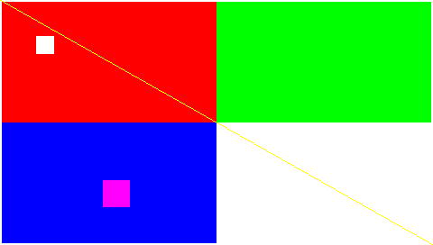

# PGM-Mac

把 PSP 时代的自制文字游戏引擎 **Pocket Game Maker (PGM)** 移植到 macOS。

> **当前状态：P1 完成（引擎在 macOS 上编译并正确渲染）。**
> 还不能跑游戏 —— PGM 的宿主层（Lua API 绑定、封包读取、场景系统）正在实现中。
> 进度见下方[路线图](#路线图)。

---

## 这是什么

[PGM](https://github.com/History-exe/PGM_CE) 是「掌机开发者之家」的白枫为 PSP 写的
AVG / 视觉小说引擎。国内现存的 PSP 自制移植游戏绝大多数都是用它做的 ——
包括《逆熵 Anti-Entropy》《幽兰黛尔》这类崩坏 3 视觉小说移植版。

它原本只支持 **PSP / Windows / Android**，从来没有 macOS 版本。这个项目要补上
这一块：让 Mac 用户能直接双击运行现成的 PGM 游戏，而不必开虚拟机或装 Wine。

## 架构

PGM 是两层结构，移植的难点完全在第二层：

```
┌─────────────────────────────────────────────┐
│  游戏内容（Lua 脚本 + 图片 + 字体 + 音频）      │  ← 纯 Lua，天然跨平台
│  src/system/*.lua, src/user/*.ev, files/     │
│  打包成 gmcode.bin / gmdata.bin              │
└──────────────────┬──────────────────────────┘
                   │  ~150 个原生 API
┌──────────────────▼──────────────────────────┐
│  PGM 宿主层（闭源，需重新实现）                │  ← 本项目的主要工作
│  LuaLibs.cpp / MyGame.cpp / PGMap.cpp       │
│  amp_package.cpp                            │
└──────────────────┬──────────────────────────┘
                   │
┌──────────────────▼──────────────────────────┐
│  NGE2 多媒体引擎（BSD/GPL，开源）              │  ← 已移植完成 ✓
│  Lua 5.1.4 · OpenGL · FreeType · SDL         │
└─────────────────────────────────────────────┘
```

* **底层 NGE2** 是开源项目（作者 Kun Wang），`include/nge_platform.h` 里甚至
  早就留了 `#define NGE_MAC`，只是从未实现。本项目补上了 Cocoa + NSOpenGL
  后端，引擎已能在 macOS 上编译并正确渲染。
* **中层 PGM 宿主** 从未发布源码，磁盘上只有 Windows/PSP/Android 二进制。
  本项目依据 PGM 自带的 Lua 框架和公开的 `PGM指令表v0.7.txt`（150 个接口、
  15 个模块）**重新实现**，属于独立实现。

## 当前进度

### ✅ P1 — 引擎在 macOS 上跑起来了

* `libnge2` 用 CMake + clang 在 macOS 14 / Apple Silicon 上编译通过
* 新增 `NGE_MAC` 后端：Cocoa 窗口 + NSOpenGL 上下文 + 事件桥接 + 键位映射
* 渲染正确性通过**像素级验证**：绘制 → `glReadPixels` 回读 → PNG



（四色分区、白色边框、位于 (40,40) 的白色方块、左上→右下黄色对角线、
y=200 处洋红方块 —— 全部落在预期位置）

### ✅ P2 — PGM 的 Lua 框架在宿主里跑起来了

* 嵌入 **Lua 5.1.4**，与 PGM 原作版本一致
* 完整链路打通：`bin/pgm.ini` → `PGSetScript("engine.sys")` →
  `PGSetState(PGM_SCRIPT)` → `engine.sys` → `PackCreate()` ×2 →
  `include("lg_init.lua")` → 逐层 include 出 **44 个脚本**的整个框架
* **零 Lua 错误**，最后 `engine.sys` 自己调用 `PGSetState(PGM_LOOP)` 进入主循环
* 注册了 **153 个原生 API**：先来自《PGM指令表v0.7.txt》的 150 个接口，
  再用脚本扫描补上文档漏掉的 100 个（合并去重后 153）
* 未实现的接口注册成**带调用位置的追踪桩**，输出形如：

  ```
  [stub] SoundCreate (1 args) <- base.lua:431
  [stub] FontCreate  (2 args) <- globals.lua:72
  ```

  这让"还差什么"一目了然，可以按调用频率逐个补实现

### ⏳ 待做

| 阶段 | 目标 | 阻塞 |
|---|---|---|
| P3 | 解码 `gmcode.bin` / `gmdata.bin` 的**载荷编码** + 图形 API，显示标题画面 | 载荷编码未解，见 [docs/PACK-FORMAT.md](docs/PACK-FORMAT.md) |
| P4 | 事件脚本、对话、存档、音频（CoreAudio）、字体，CE 示例游戏可通关 | — |
| P5 | `.app` 打包、拖放游戏目录、中文文档 | — |

## 构建

需要 macOS + Xcode Command Line Tools。

```sh
# 依赖（任选其一）
brew install libpng jpeg-turbo giflib freetype
# 或
sudo port install libpng libjpeg-turbo giflib freetype

# 构建
./scripts/build.sh

# 跑 P1 验收测试（会弹出窗口并写出 PNG）
./build/Debug/p1_smoke 20 /tmp/p1_smoke.png
```

期望输出：

```
Init Graphics Ok
p1_smoke: rendering 20 frames at 480x272
after init: viewport=480x272+0+0 scissor=480x272+0+0 screen=480x272 ori=480x272
p1_smoke: wrote /tmp/p1_smoke.png
p1_smoke: done (rc=0)
```

## 目录结构

```
pgm-mac/
├── scripts/
│   ├── apply_mac_patches.py   # 对 libnge2 打 macOS 补丁（幂等 + 断言校验）
│   └── build.sh               # 一键构建 + 验收测试
├── tests/
│   └── p1_smoke.c             # P1 验收测试（不依赖外部素材）
├── docs/
│   ├── PORTING-NOTES.md       # 逐条记录对上游的改动，含踩过的坑
│   └── LICENSING.md           # 上游许可证自相矛盾的分析与取舍
└── third_party/
    └── libnge2/               # NGE2 源码（已打补丁）
```

## 已经踩过的坑（都记在 `docs/PORTING-NOTES.md`）

* **上游 `ScreenToImage()` 的行跨距 bug** —— `image_create()` 把纹理尺寸向上取整到
  2 的幂（480×272 → 512×512），但 `glReadPixels` 按紧凑宽度写，逐行错位累积，
  画面被切成斜条纹。这是**所有平台都有**的问题，用 `GL_PACK_ROW_LENGTH` 修掉。
* **macOS 10.14+ 的强制 layer-backing** —— 用普通 `NSView` + `NSOpenGLContext
  setView:` 时，窗口会变成透明空壳：`glReadPixels` 能读回正确画面，AppKit 也报告
  `visible=1, keyWindow=1`，但屏幕上什么都没有。必须换成 `NSOpenGLView`。
* **`NSOpenGLView` 析构顺序** —— 它拥有自己的 context，手动 `release` 会在
  `-[NSOpenGLView dealloc]` 里访问悬垂对象而崩溃。

## 许可证

**GPL-2.0-or-later**，见 [LICENSE](LICENSE)。

之所以不用 BSD：上游 NGE2 的 README 写「采用BSD许可证」，但 43 个源文件头里
写的是 GPL v2+，两者矛盾。GPL-2.0-or-later 是**在两种解释下都成立**的唯一选择。
详细分析和改成 BSD 的前提条件见 [docs/LICENSING.md](docs/LICENSING.md)。

## 致谢

* **白枫 / 掌机开发者之家** —— PGM 引擎与游戏框架作者
* **Kun Wang** —— NGE2 引擎作者
* **History_exe** —— [PGM_CE](https://github.com/History-exe/PGM_CE) 魔改版维护者

本项目不包含任何游戏资源；游戏内容的版权归各自原作者所有。
详见 [NOTICE.md](NOTICE.md)。

---

PSP、PlayStation Portable 是 Sony Interactive Entertainment 的商标，本项目与 Sony 无关。
